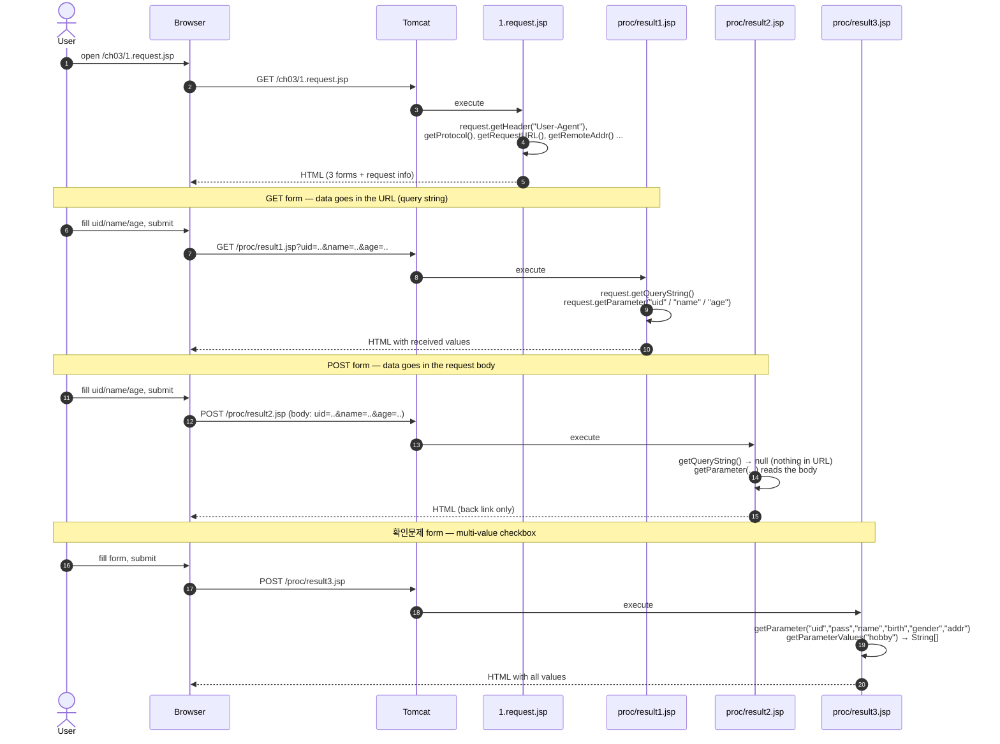
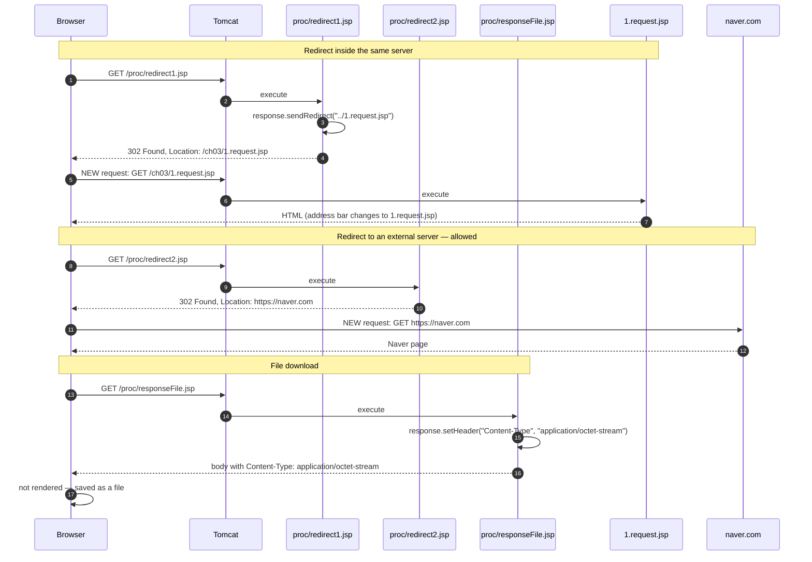
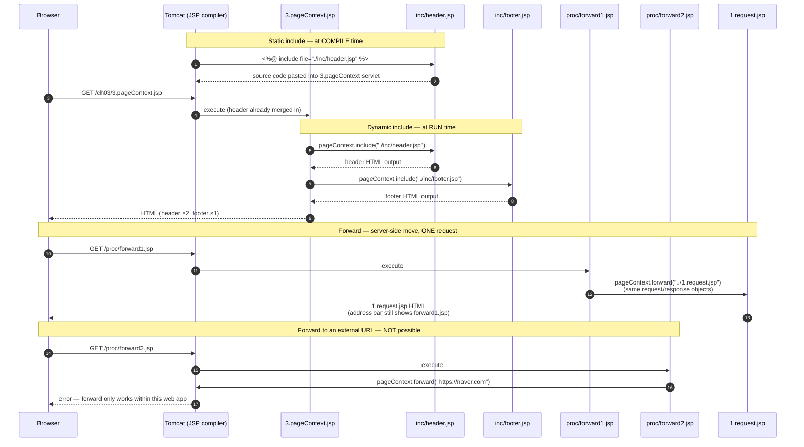
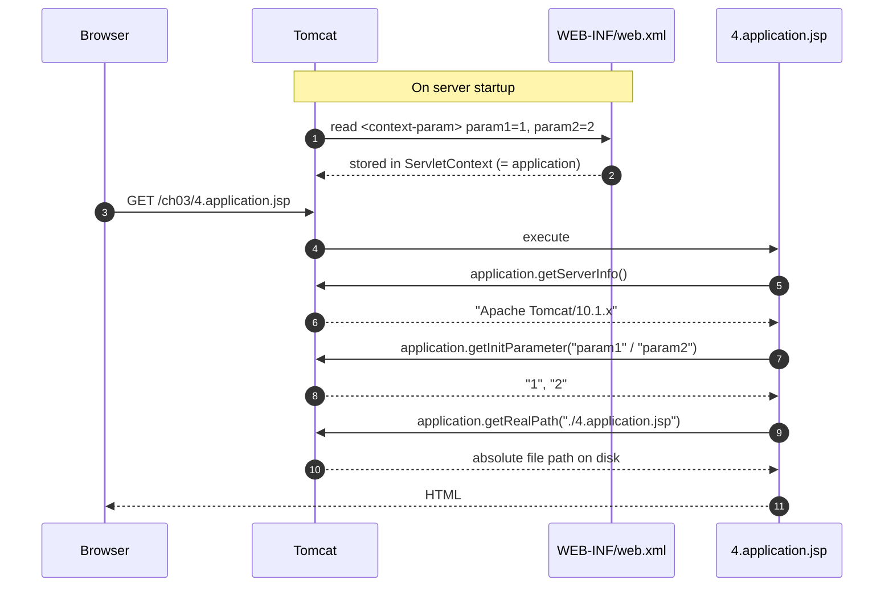
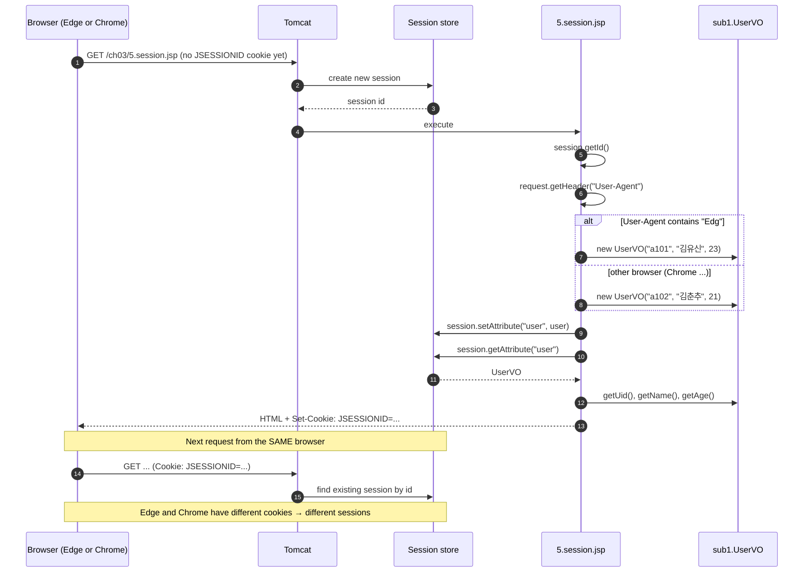
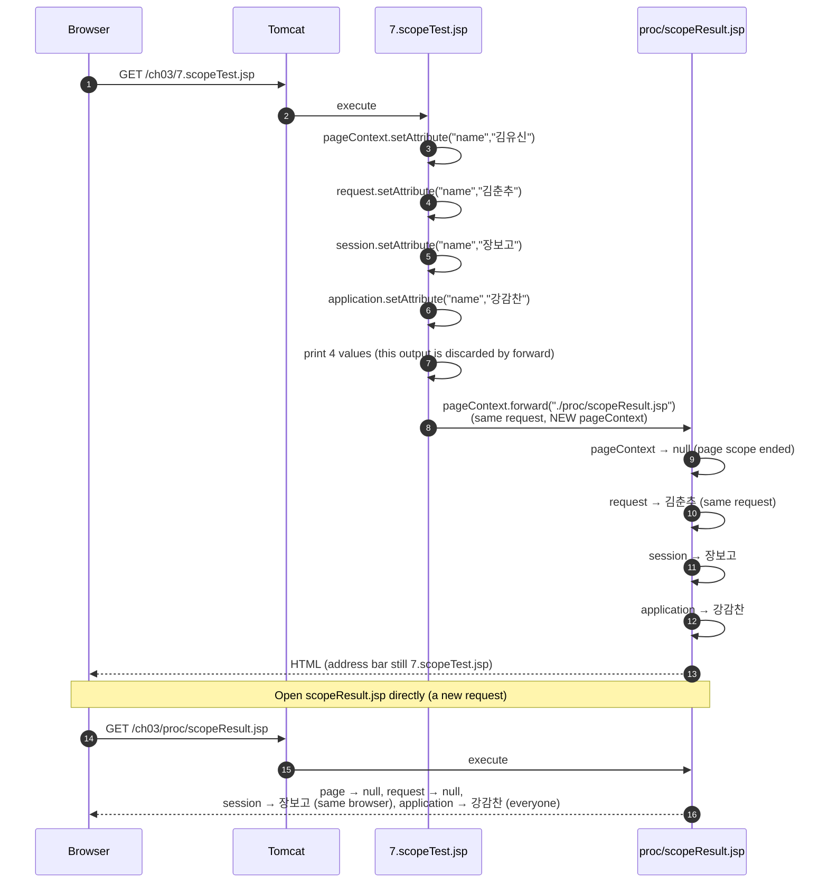

# ch03 Sequence Diagrams — JSP 내장객체 (Implicit Objects)

How each ch03 page flows between the **Browser**, **Tomcat**, and the JSP pages.
Open this file with Markdown Preview (VS Code: `Cmd+Shift+V`) to render the Mermaid diagrams.

---

## 1. `request` — GET / POST form submission



> ⚠️ In `result3.jsp`, if no gender or no hobby is selected, `gender.equals(...)` / `for (hobby : hobbies)` throws `NullPointerException` → Tomcat shows `/error/500.jsp` (see section 6).

---

## 2. `response` — redirect & file download



**Key point:** a redirect is **2 requests**. The server tells the browser *"go ask over there"*, so the URL changes and the original `request` object is gone.

---

## 3. `pageContext` — include & forward



> ⚠️ The `<a href="./proc/forward1.jsp"></a>` links in `3.pageContext.jsp` have no text, so they're invisible on the page. Type the URL directly, or add link text.

### Redirect vs Forward

| | `response.sendRedirect()` | `pageContext.forward()` |
|---|---|---|
| Requests | 2 (browser re-requests) | 1 (server moves internally) |
| Address bar | changes | stays the same |
| `request` attributes | lost | kept |
| External site | ✅ possible | ❌ not possible |

---

## 4. `application` — server info & web.xml params



---

## 5. `session` — per-browser storage



---

## 6. `exception` — error pages via web.xml

```mermaid
sequenceDiagram
    autonumber
    participant B as Browser
    participant T as Tomcat
    participant W as web.xml &lt;error-page&gt;
    participant ERR as proc/error.jsp
    participant E404 as error/404.jsp
    participant E500 as error/500.jsp

    Note over B,E404: 404 — page does not exist
    B->>T: GET /proc/test.jsp
    T->>T: file not found
    T->>W: lookup error-code 404
    W-->>T: /error/404.jsp
    T->>E404: forward
    E404-->>B: "페이지를 찾을 수 없습니다."

    Note over B,E500: 500 — exception while running
    B->>T: GET /proc/error.jsp
    T->>ERR: execute
    ERR->>ERR: 10 / 0 → ArithmeticException
    ERR-->>T: exception thrown
    T->>W: lookup error-code 500
    W-->>T: /error/500.jsp
    T->>E500: forward (isErrorPage="true" → exception object available)
    E500->>E500: exception.getClass().getName()<br/>exception.getMessage() → "/ by zero"
    E500-->>B: "일시적으로 서버에 문제가 생겼습니다."
```

---

## 7. Scope test — page / request / session / application



| Scope | Lives until | Shared with |
|---|---|---|
| `pageContext` | this JSP finishes | this page only |
| `request` | the response is sent (survives forward) | pages in the same request |
| `session` | browser closes / timeout | same browser (JSESSIONID) |
| `application` | server stops | all users |

> ⚠️ The link in `scopeResult.jsp` is `./ch03/proc/scopeResult.jsp`. Because the address bar is still `/ch03/7.scopeTest.jsp`, it resolves to `/ch03/ch03/proc/scopeResult.jsp` → 404. Use `/ch03/proc/scopeResult.jsp` instead.
